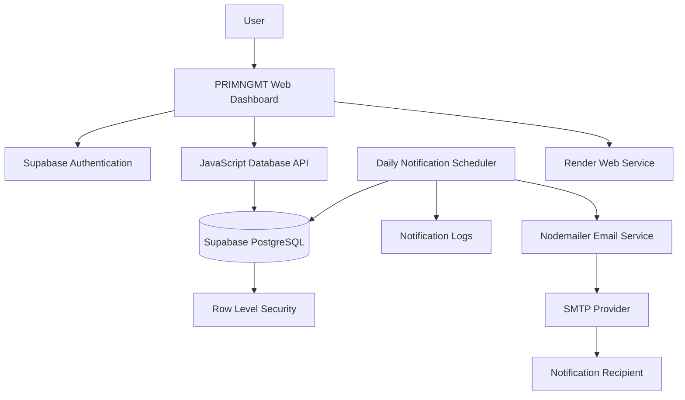

# 🚀 PRIMNGMT
### Personal Project Management & Productivity Dashboard

<p align="center">
  <strong>Plan. Organize. Track. Complete.</strong>
  <br/>
  A personal productivity workspace designed to bring projects, tasks, schedules, and deadlines together.
</p>

<p align="center">
  
  
  
  
  
</p>

---

## ✨ Overview

**PRIMNGMT** (Personal Project Management) is a modern, responsive, web-based productivity application built exclusively for individual use.

It provides a centralized workspace to manage personal projects, organize tasks, maintain daily/weekly/monthly to-do lists, visualize schedules through interactive Gantt charts, monitor deadlines, and automatically receive email reminders.

Designed with a modern dark interface and a cloud-backed architecture, PRIMNGMT combines project organization, scheduling, productivity tracking, and automated notifications into one application.

### 🎯 Core Objectives

- Centralize personal projects and everyday responsibilities.
- Visualize project schedules, task dependencies in timelines, and deadlines.
- Maintain structured daily, weekly, and monthly to-do lists.
- Track completed activities with historical records and performance metrics.
- Receive automated deadline and overdue email reminders.
- Maintain persistent cloud data with Supabase authentication and Row Level Security.

---

## 🌟 Key Features

### 1. 📊 Interactive Productivity Dashboard

- Centralized overview of personal projects and tasks.
- Project and task completion metrics.
- Pending, completed, and upcoming activity summaries.
- Upcoming deadlines and important milestones.
- Quick access to different productivity modules.

### 2. 📁 Project & Task Management

**Personal Project Management**

Create and manage projects with:

- Project name and description.
- Category: Development, Design, Personal, Research, Writing, Finance, General, Other.
- Priority: Low, Medium, High, Critical.
- Start date and target/deadline date.
- Project status and completion progress.

**Project Task Management**

- Create multiple tasks under individual projects.
- Maintain task descriptions and deadlines.
- Set task priorities and completion status.
- Track task progress and completion timestamps.
- Automatically synchronize completed activities with historical records.

### 3. 📝 Digital Sticky Notes Workspace

A visual to-do management system with three scheduling cadences:

- Daily To-Dos
- Weekly To-Dos
- Monthly To-Dos

**Sticky Notes Experience**

- Card-based digital pinboard layout.
- Six pastel colour variations:
  - Warm Amber
  - Sunset Peach
  - Mint Herbal
  - Sky Azure
  - Soft Lavender
  - Rose Blush
- Subtle card rotation and hover elevation.
- Adhesive tape-inspired visual styling.
- Completed-note watermark and strikethrough typography.
- Responsive pinboard grid.

### 4. 📅 Interactive Monthly Calendar

A consolidated calendar that displays all scheduled activities in one place.

**Calendar Capabilities**

- Defaults to the current month.
- Previous month, next month, and Today navigation.
- Unified display of:
  - Projects
  - Project Tasks
  - Daily To-Dos
  - Weekly To-Dos
  - Monthly To-Dos
- Colour-coded activity identifiers:
  - Projects — Purple
  - Tasks — Blue
  - Daily To-Dos — Green
  - Weekly To-Dos — Amber
  - Monthly To-Dos — Rose
- Displays up to three activity pills per date with a `+N more` expander.
- Interactive Day View Drawer.
- Activity Detail Modal.
- Highlighted current-day marker.

### 5. 📈 Interactive Project Gantt Charts

Visualize project timelines and monitor task progress through dedicated Gantt charts.

**Timeline Features**

- Switch between projects using a project selector.
- Master project duration bar.
- Individual task timeline bars.
- Three timeline scales:
  - Daily
  - Weekly
  - Monthly
- Fixed task information column.
- Horizontally scrollable timeline.
- Dynamic vertical TODAY indicator using the `Asia/Kolkata` timezone.

**Visual Status Indicators**

| Status | Visualization |
|---|---|
| Completed | Emerald Green with checkmark |
| In Progress | Indigo |
| Overdue | Red |

### 6. 📧 Automated Email Notification Engine

PRIMNGMT includes an automated email reminder engine powered by Node.js, Nodemailer, and Supabase notification logs.

**Default Notification Recipient**

`priyank.saxena.dev@gmail.com`

**Notification Rules**

| Trigger | Email Behaviour |
|---|---|
| Project deadline | Reminder exactly 2 days before |
| Project task deadline | Reminder exactly 2 days before |
| Daily To-Do deadline | Reminder exactly 2 days before |
| Weekly To-Do deadline | Reminder exactly 2 days before |
| Monthly To-Do deadline | Reminder exactly 2 days before |
| Incomplete overdue item | Daily reminder until completed |
| Completed item | Further reminders stop immediately |

**Reliability & Delivery**

- Automated daily notification execution.
- Scheduling anchored to `Asia/Kolkata` (IST).
- Professional responsive HTML email templates.
- Countdown and overdue notification banners.
- Item metadata and associated project information.
- Direct dashboard links in notification emails.
- Supabase-based notification delivery tracking.
- Deduplication and idempotency protection.

**Notification Deduplication**

The `email_notification_logs` table uses a unique constraint:

```sql
UNIQUE(item_id, notification_type, reference_date)
```

This prevents duplicate notification deliveries when the scheduler executes repeatedly for the same item and notification date.

### 7. 🏆 Completion Tracking History

Maintain a persistent historical record of completed activities.

**History Features**

- Completed projects.
- Completed project tasks.
- Completed daily, weekly, and monthly to-dos.
- Reverse chronological ordering.
- Original deadline and actual completion timestamp.
- Associated project information.
- IST-based completion timestamps.

**Timeliness Performance**

| Badge | Meaning |
|---|---|
| On Time | Completed by the deadline |
| X Days Early | Completed before the deadline |
| X Days After Deadline | Completed after the deadline |

Additional capabilities include activity-type filtering and title-based search.

### 8. 🎨 Modern Midnight-Inspired UI

- Eye-comfort dark interface.
- Muted teal and sage colour palette.
- Animated gradient backgrounds.
- Smooth card transitions and hover effects.
- Subtle theme-matched glow effects.
- Custom scrollbars.
- Interactive pill tabs and modals.
- Responsive layouts.

---

## 🛠️ Technology Stack

PRIMNGMT follows a lightweight architecture with no frontend frameworks.

| Layer | Technology | Responsibility |
|---|---|---|
| Frontend | HTML5 | Application structure |
| Styling | CSS3 | Layout, animations, responsive design |
| Frontend Logic | Vanilla JavaScript ES6+ Modules | Application functionality |
| Backend | Node.js | Server-side runtime |
| Database | Supabase PostgreSQL | Persistent application storage |
| Authentication | Supabase Auth | Email/password authentication |
| Database Security | Supabase RLS | User-level data isolation |
| Email Engine | Nodemailer | SMTP email delivery |
| Scheduling | Node.js Cron / GitHub Actions | Automated notification execution |
| Hosting | Render | Web application deployment |
| Version Control | Git & GitHub | Source code management |

**Frontend architecture restriction:** No React, Next.js, Vue, Angular, TypeScript, or other frontend frameworks.

---

## 🏗️ Application Architecture



### Architecture Highlights

- Vanilla JavaScript frontend.
- Supabase-powered authentication and database.
- Row Level Security for user-owned records.
- Server-side scheduled notification execution.
- Environment-based credential management.
- Separate notification delivery and logging components.

---

## 📂 Project Directory Structure

```text
PersonalProjectManagement/
│
├── index.html
├── server.js
├── package.json
├── package-lock.json
│
├── .env.example
├── .gitignore
├── README.md
│
├── css/
│   ├── main.css
│   ├── components.css
│   ├── auth.css
│   ├── dashboard.css
│   ├── projects.css
│   ├── todos.css
│   ├── calendar.css
│   ├── gantt.css
│   └── history.css
│
├── js/
│   ├── app.js
│   ├── config.js
│   ├── auth.js
│   ├── api.js
│   │
│   ├── views/
│   │   ├── dashboard.js
│   │   ├── projects.js
│   │   ├── todos.js
│   │   ├── calendar.js
│   │   ├── gantt.js
│   │   └── history.js
│   │
│   └── utils/
│       ├── date-utils.js
│       └── notifications.js
│
├── backend/
│   ├── email-service.js
│   ├── scheduler.js
│   ├── test-email.js
│   └── verify-db.js
│
└── supabase/
    └── schema.sql
```

*Directory structure represents the documented application architecture. Adjust it if your repository contains additional files or different names.*

---

## 🗄️ Supabase Database Setup

PRIMNGMT uses Supabase PostgreSQL for persistent cloud storage and Supabase Authentication for account management.

### Database Tables

| Table | Purpose |
|---|---|
| `projects` | Personal project records |
| `project_tasks` | Project-related tasks |
| `todos` | Daily, weekly, and monthly to-do records |
| `completion_history` | Completed activity history |
| `email_notification_logs` | Notification delivery tracking and deduplication |

### Row Level Security (RLS)

RLS is enabled on all user-owned tables.

The access policy ensures that users can only access records associated with their authenticated identity:

```sql
auth.uid() = user_id
```

The background notification scheduler uses the Supabase service-role key for authorized server-side operations.

**Security:** The service-role key must never be exposed in frontend JavaScript or committed to GitHub.

### Apply Database Schema

Use the Supabase SQL Editor to execute:

```text
supabase/schema.sql
```

Alternatively, use the Supabase CLI if your project is linked and your installed CLI supports the command:

```bash
supabase db query --linked -f supabase/schema.sql
```

---

## ⚙️ Getting Started

### Prerequisites

Install the following:

- [Node.js](https://nodejs.org/)
- [npm](https://www.npmjs.com/)
- [Git](https://git-scm.com/)
- [Supabase Account](https://supabase.com/)

### 1. Clone the Repository

```bash
git clone https://github.com/YOUR_USERNAME/PRIMNGMT.git
cd PRIMNGMT
```

### 2. Install Dependencies

```bash
npm install
```

### 3. Configure Environment Variables

Create a `.env` file in the project root using `.env.example` as the template.

```env
# Supabase Configuration
SUPABASE_URL=
SUPABASE_ANON_KEY=
SUPABASE_SERVICE_ROLE_KEY=

# Notification Recipient
NOTIFICATION_RECIPIENT=your-email@example.com

# SMTP Configuration
SMTP_HOST=
SMTP_PORT=587
SMTP_SECURE=false
SMTP_USER=
SMTP_PASS=
SMTP_FROM=

# Application Configuration
APP_URL=http://localhost:3000
```

Configure the actual values from your Supabase project and email provider.

**Never commit `.env` to GitHub.**

### 4. Start the Application

```bash
npm start
```

Open:

```text
http://localhost:3000
```

Sign in using your configured Supabase account.

---

## 📬 Email Notification Setup

### Local Gmail SMTP Configuration

For local development, Gmail SMTP can be configured using a Google App Password where eligible.

```env
SMTP_HOST=smtp.gmail.com
SMTP_PORT=587
SMTP_SECURE=false
SMTP_USER=your-email@gmail.com
SMTP_PASS=your-google-app-password
SMTP_FROM=PRIMNGMT <your-email@gmail.com>
```

Do not use your regular Gmail password.

### Email Testing

Run:

```bash
npm run test:email
```

### Execute Notification Scheduler Manually

```bash
npm run notify
```

### Run Daily Scheduler Locally

```bash
npm run notify:cron
```

The daily scheduler is configured for 09:00 AM IST.

---

## ☁️ Production Deployment

PRIMNGMT can be deployed using Render and GitHub Actions.

### A. Web Application — Render

Recommended Render Web Service configuration:

| Setting | Value |
|---|---|
| Service Type | Web Service |
| Runtime | Node.js |
| Branch | `main` |
| Build Command | `npm install` |
| Start Command | `npm start` |
| Instance | Free |

The Node.js server must listen on the Render-provided `PORT` and bind to `0.0.0.0`.

Configure production environment variables in the Render dashboard.

**Important Render Free considerations:**

- Free web services spin down after periods of inactivity.
- The local filesystem is ephemeral; persistent records must remain in Supabase.
- Outbound SMTP ports 25, 465, and 587 are blocked on free instances.

For production email delivery, use a compatible SMTP relay on a supported port, or an HTTPS-based email API. Verify provider availability, sending limits, and connectivity before deployment.

### B. Daily Email Notifications — GitHub Actions

GitHub Actions can execute the notification scheduler independently of the Render web service.

Create:

```text
.github/workflows/daily-reminders.yml
```

Add:

```yaml
name: Daily Deadline Notifications

on:
  schedule:
    - cron: '30 3 * * *' # 09:00 AM IST (03:30 UTC)
  workflow_dispatch:

jobs:
  notify:
    runs-on: ubuntu-latest

    steps:
      - name: Checkout repository
        uses: actions/checkout@v4

      - name: Setup Node.js
        uses: actions/setup-node@v4
        with:
          node-version: 20
          cache: npm

      - name: Install dependencies
        run: npm ci

      - name: Execute notification scheduler
        run: npm run notify
        env:
          SUPABASE_URL: ${{ secrets.SUPABASE_URL }}
          SUPABASE_SERVICE_ROLE_KEY: ${{ secrets.SUPABASE_SERVICE_ROLE_KEY }}
          SMTP_HOST: ${{ secrets.SMTP_HOST }}
          SMTP_PORT: ${{ secrets.SMTP_PORT }}
          SMTP_SECURE: ${{ secrets.SMTP_SECURE }}
          SMTP_USER: ${{ secrets.SMTP_USER }}
          SMTP_PASS: ${{ secrets.SMTP_PASS }}
          SMTP_FROM: ${{ secrets.SMTP_FROM }}
          NOTIFICATION_RECIPIENT: ${{ secrets.NOTIFICATION_RECIPIENT }}
          APP_URL: ${{ secrets.APP_URL }}
          TZ: Asia/Kolkata
```

Add the required credentials through:

**GitHub Repository → Settings → Secrets and variables → Actions → New repository secret**

Do not hardcode credentials in the workflow file.

**Scheduling note:** GitHub Actions scheduled workflows use UTC. The above cron expression corresponds to 09:00 AM IST. GitHub scheduled runs can be delayed, and public repositories may have scheduled workflows disabled after prolonged inactivity. Check the workflow run history to verify successful executions.

### Production Scheduling Recommendation

Use:

- **Render:** Host the web application.
- **GitHub Actions:** Run the daily notification job.
- **Supabase:** Store application records and notification logs.
- **Email provider:** Deliver production notification emails.

The web application and notification scheduler are separate processes, so a sleeping Render web service does not need to be awake for a GitHub Actions notification run.

---

## 🔐 Security Practices

- Never commit `.env` or private credentials.
- Keep the Supabase service-role key server-side.
- Apply RLS policies to all user-owned database tables.
- Validate user input before database operations.
- Use secure authentication and persistent sessions.
- Use HTTPS for production access.
- Store GitHub Actions secrets in repository settings.
- Keep email credentials private.
- Protect scheduled notification operations from duplicate execution.

---

## 🧪 Verification & Testing

PRIMNGMT includes dedicated scripts for checking database integration and email functionality.

| Command | Purpose |
|---|---|
| `npm start` | Start the application |
| `npm run test:email` | Verify email configuration |
| `npm run notify` | Execute a notification cycle |
| `npm run notify:cron` | Start the local daily scheduler |
| `npm run db:verify` | Run database integration verification |

---

## 🗺️ Future Enhancements

Potential improvements for future releases:

- [ ] Advanced productivity analytics.
- [ ] Enhanced Gantt timeline interactions.
- [ ] Exportable project reports.
- [ ] Additional calendar visualizations.
- [ ] Improved mobile experience.
- [ ] More flexible reminder configuration.

---

## 🤝 Contributions & Feedback

PRIMNGMT is designed as an individual productivity application.

Suggestions, bug reports, and improvements are welcome.

1. Fork the repository.
2. Create a feature branch.
3. Commit your changes.
4. Submit a pull request.

---

## 👨‍💻 Author

**Priyank Saxena**

- GitHub: [@PriyankV25](https://github.com/PriyankV25)
- LinkedIn: [Priyank Saxena](https://www.linkedin.com/in/priyanksaxenaps/)
- Portfolio: [Personal Portfolio](https://priyank-saxena-portfolio.onrender.com/)
- Dev Community: [@priyank_dev](https://dev.to/priyank_dev)

---

## 📄 License

Choose and add a license file before distributing this project. No license is implied by this README alone.

---

<p align="center">
  <strong>PRIMNGMT</strong>
  <br/>
  Your projects. Your priorities. Your progress.
  <br/><br/>
  Built with ❤️ by Priyank Saxena.
</p>